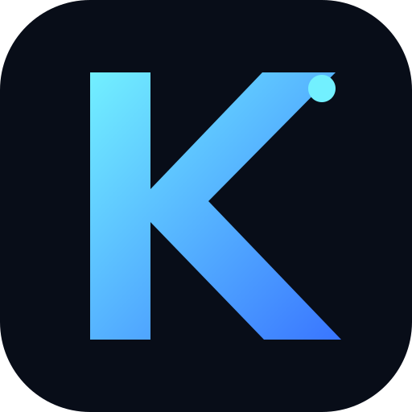

# KRYTON ECOSYSTEM

### Intelligence without boundaries.

**Ecosistema modular de inteligencia artificial multimodal.**

[REPOSITORIO](https://github.com/Salazar19-Kgr/krypton-ecosystem-) · [ARQUITECTURA](docs/ARCHITECTURE.md) · [SEGURIDAD](SECURITY.md)

---

## 01 · Visión

KRYTON ECOSYSTEM integra modelos de IA, análisis multimodal, información externa, memoria, sesiones y herramientas especializadas dentro de una arquitectura común. Su objetivo es reunir capacidades independientes en una plataforma coherente, extensible y mantenible.

## 02 · Ecosistema de módulos

| Módulo | Propósito |
|:--|:--|
| **CORE** | Conversación, razonamiento, matemáticas, búsqueda y archivos. |
| **HEALTH** | Espacio especializado en información de salud. |
| **TOOLS** | Productividad, documentos, cuestionarios y PDF. |
| **PLATFORM** | Pruebas, experimentación y calidad. |
| **SENTINEL** | Ciberseguridad defensiva e investigación OSINT. |

*La disponibilidad de cada capacidad depende de su implementación y configuración actuales.*

## 03 · Stack tecnológico

| Tecnología | Función |
|:--|:--|
| Next.js | Framework de aplicación y App Router |
| React | Interfaces de usuario |
| TypeScript | Desarrollo tipado |
| Tailwind CSS | Sistema de estilos |
| Supabase | Backend y persistencia |
| Google GenAI | Integración de inteligencia artificial |
| Python | Procesamiento complementario |

## 04 · Principios

- **Modularidad:** capacidades separadas por responsabilidad.
- **Interoperabilidad:** integración de distintos proveedores.
- **Multimodalidad:** soporte para diversos formatos de información.
- **Seguridad:** protección de credenciales, sesiones y datos.
- **Mantenibilidad:** componentes y servicios organizados.
- **Evolución:** crecimiento progresivo y controlado.

## 05 · Estructura

| Directorio | Responsabilidad |
|:--|:--|
| `.github/` | Automatizaciones de GitHub |
| `aplicación/` | Aplicación y rutas |
| `componentes/` | Componentes reutilizables |
| `biblioteca/` | Módulos compartidos |
| `público/` | Recursos públicos |
| `guiones/` | Scripts auxiliares |
| `assets/` | Identidad visual |
| `docs/` | Documentación técnica |

## 06 · Documentación

- [Arquitectura](docs/ARCHITECTURE.md)
- [Guía del repositorio](docs/REPOSITORY_GUIDE.md)
- [Contribuciones](CONTRIBUTING.md)
- [Seguridad](SECURITY.md)

## 07 · Estado

**EN DESARROLLO ACTIVO · 2026**

KRYTON ECOSYSTEM continúa evolucionando en arquitectura, integraciones y capacidades de inteligencia artificial.

---

**KRYTON ECOSYSTEM**

*One ecosystem. Multiple capabilities. One evolving intelligence platform.*

